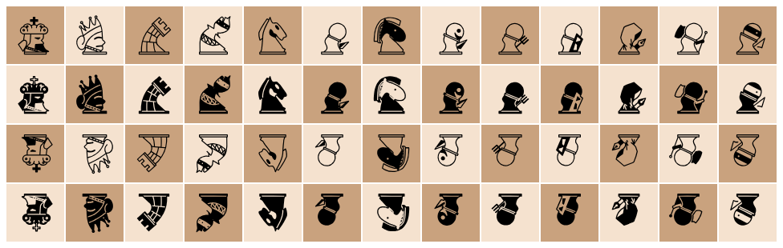

# heterodox_chess_fonts

フェアリーチェス（変則チェス）の駒のフォント。13駒 × 4種の52グリフを、私用領域 U+E900〜U+E933 に置いている。



上の行から 白抜き正立・黒塗り正立・白抜き 180° 回転・黒塗り 180° 回転。

## ファイル

| ファイル | 中身 |
|---|---|
| `heterodox_chess.ttf` | 使う側が読むフォント |
| `heterodox_chess.sfd` | FontForge の元データ。直すときはこちらを直して ttf を書き出す |
| `names.json` | 正式名称 → コードポイント（`"king_w": "U+E900"` の形） |
| `mozc_dictionary.txt` | Mozc のユーザー辞書に取り込むファイル（読みは駒の名前のかな、コメントが正式名称） |
| `specimen.png` | 上の一覧 |
| `OFL.txt` | ライセンスの全文（SIL Open Font License 1.1） |

## 文字の割り当てと名前

```
コードポイント = 0xE900 + 4 × (駒番号 − 1) + (種類 − 1)
```

それぞれの字には `<駒の名前>_<種類>` の正式名称がある。フォントの中のグリフ名もこの名前で、
名前からコードポイントへの対応は `names.json` にある。

| 種類 | 接尾辞 | 意味 |
|---|---|---|
| 1 | `w` | 白抜き正立 |
| 2 | `b` | 黒塗り正立 |
| 3 | `rw` | 白抜き 180° 回転（rotated white） |
| 4 | `rb` | 黒塗り 180° 回転（rotated black） |

| 駒番号 | 駒 | w | b | rw | rb |
|---|---|---|---|---|---|
| 1 | king | `king_w` U+E900 | `king_b` U+E901 | `king_rw` U+E902 | `king_rb` U+E903 |
| 2 | queen | `queen_w` U+E904 | `queen_b` U+E905 | `queen_rw` U+E906 | `queen_rb` U+E907 |
| 3 | rook | `rook_w` U+E908 | `rook_b` U+E909 | `rook_rw` U+E90A | `rook_rb` U+E90B |
| 4 | bishop | `bishop_w` U+E90C | `bishop_b` U+E90D | `bishop_rw` U+E90E | `bishop_rb` U+E90F |
| 5 | knight | `knight_w` U+E910 | `knight_b` U+E911 | `knight_rw` U+E912 | `knight_rb` U+E913 |
| 6 | pawn | `pawn_w` U+E914 | `pawn_b` U+E915 | `pawn_rw` U+E916 | `pawn_rb` U+E917 |
| 7 | nightrider | `nightrider_w` U+E918 | `nightrider_b` U+E919 | `nightrider_rw` U+E91A | `nightrider_rb` U+E91B |
| 8 | madman | `madman_w` U+E91C | `madman_b` U+E91D | `madman_rw` U+E91E | `madman_rb` U+E91F |
| 9 | peasant | `peasant_w` U+E920 | `peasant_b` U+E921 | `peasant_rw` U+E922 | `peasant_rb` U+E923 |
| 10 | guard | `guard_w` U+E924 | `guard_b` U+E925 | `guard_rw` U+E926 | `guard_rb` U+E927 |
| 11 | researcher | `researcher_w` U+E928 | `researcher_b` U+E929 | `researcher_rw` U+E92A | `researcher_rb` U+E92B |
| 12 | standard | `standard_w` U+E92C | `standard_b` U+E92D | `standard_rw` U+E92E | `standard_rb` U+E92F |
| 13 | scout | `scout_w` U+E930 | `scout_b` U+E931 | `scout_rw` U+E932 | `scout_rb` U+E933 |

U+E900 からにしているのは、ほかのフォントと番号がぶつからないようにするため（U+E000 台は Adwaita Sans や
MathJax のフォント、Nerd Fonts が使っている）。ぶつからなければ、フォントを指定していない場所でもこのフォントが選ばれる。
Chromium 系のブラウザは私用領域の字に代替フォントを探さないので、`font-family` での指定が要る。

## 寸法

- em は 1024。全グリフの送り幅が 1024 で、升目は正方形
- 回転版は em の中心で 180° 回してあるので、正立と同じ升目に収まる

## 使い方（CSS）

```css
@font-face {
  font-family: "HeterodoxChess";
  src: url("fonts/heterodox_chess.ttf") format("truetype");
  font-display: swap;
}
.square { font-family: "HeterodoxChess", serif; }
```

```js
// 駒番号 piece（1〜13）、種類 variant（1〜4）
const glyph = String.fromCharCode(0xE900 + 4 * (piece - 1) + (variant - 1));

// 名前から（names.json を読んで）
const ch = (name) => String.fromCodePoint(parseInt(names[name].slice(2), 16));
ch("king_w");
```

## ライセンス

Copyright (c) 2026, Crux-xurC

[SIL Open Font License 1.1](OFL.txt)。誰でも、商用も含めて、使用・改変・再配布・ソフトウェアへの同梱ができる。
条件は、フォント単体で売らないこと、再配布するときに著作権表示とこのライセンスを付けること、改変版も同じライセンスにすること。
